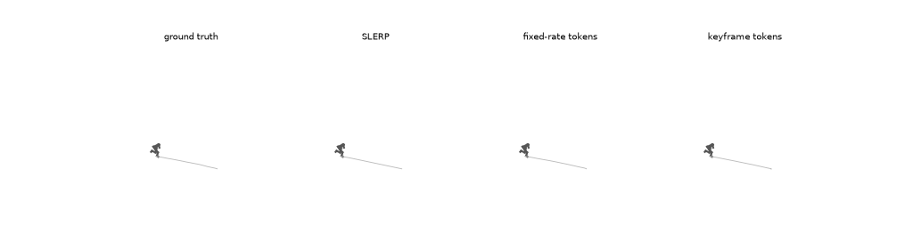
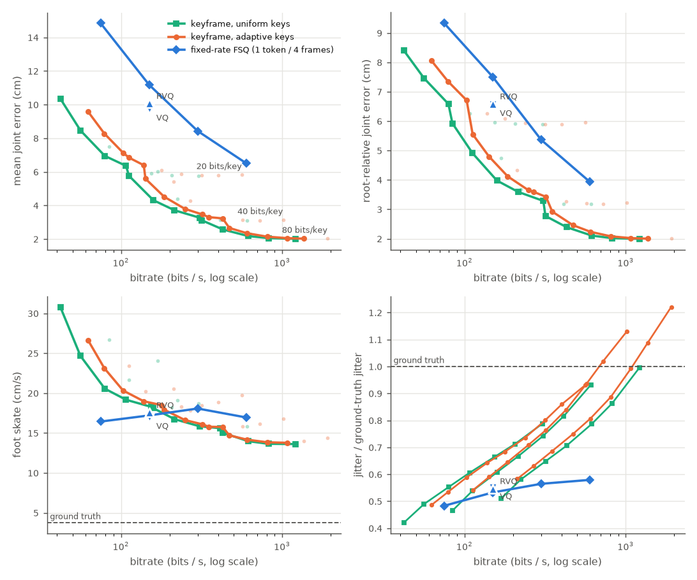
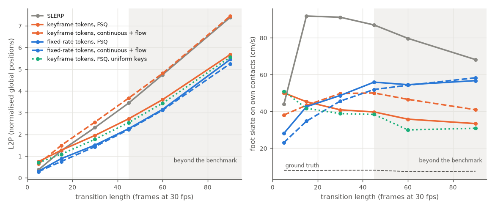
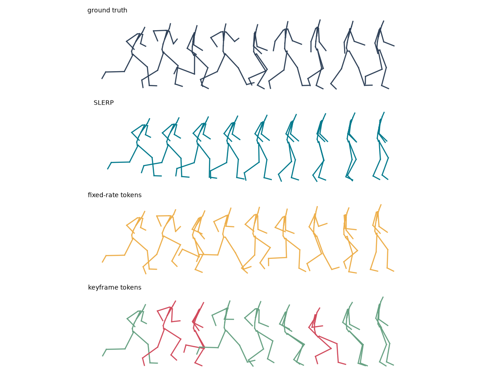

# Keyframe Tokens: where should a motion tokenizer spend its bits?

A controlled study of **fixed-rate** vs **keyframe** motion tokens at matched bitrate on LAFAN1, as
compressors (rate-distortion) and as the vocabulary of a generative in-betweening model, discrete
and continuous, on the same backbone.



## Findings

1. **As compressors, keyframe tokens win at every bitrate.** From 75 to 600 bits/s, a keyframe
   tokenizer reconstructs held-out motion with 33-47% of the error of the best fixed-rate tokenizer,
   whether that uses FSQ, VQ or residual VQ. It matches the fixed-rate error with 5-6× fewer bits.
   The gain comes from *what a token is*: a whole pose, coded predictively against the previous decoded
   key and filled in by a learned in-betweener. It does not come from *where* keys go. Adaptive
   placement stops helping once the in-betweener is learned.
2. **Bits belong in the key, not in more keys.** Each keyframe model levels off at an error set by
   its pose code: 5.8, 3.1 and 2.0 cm for 20-, 40- and 80-bit keys. Beyond 4-8 keys per second, extra
   bits are better spent on each key.
3. **As a generator's vocabulary, keyframe tokens lose.** The same 5 M-parameter autoregressive transformer
   in-betweens worse over keyframe tokens than over fixed-rate tokens at every gap: L2P 2.72 vs 2.27
   at 45 frames. This holds even though the keyframe tokens decode the ground truth about twice as
   accurately. Predictive codes have had their predictable part removed, so the generator has to
   guess 75% of each token's bits (fixed-rate: 54%). A one-level code mistake also moves the motion 3-4× as far.
4. **Quantization is not the cause.** Swapping codes for continuous latents and a flow-matching
   head barely changes the fixed-rate generator (2% at gap 45). It makes the keyframe generator worse,
   to no better than SLERP.
5. **Keyframe tokens still keep feet planted.** On the motion's own foot contacts, keyframe
   in-betweens skate 29-46% less than fixed-rate ones at gaps of 45-90 frames. They also go through
   the floor less than half as much. L2P ranks the generators the other way.

**Takeaway.** A motion tokenizer's reconstruction error does not predict how well a generator can
model its tokens. In-betweening L2P does not predict physical plausibility either. Tokenizers for
motion generation should be chosen by the generator trained on them, and judged on physical metrics
alongside the benchmark.

*Scope:* LAFAN1 only, one seed per configuration, and small models trained in about 45 GPU-hours on a
4 GB laptop GPU. This is a controlled comparison, not a state-of-the-art in-betweener; see
[Limitations](#limitations).

## Contents

- [Why this question](#why-this-question)
- [Setup](#setup) and [representations](#representations)
- [Experiment 0](#experiment-0-what-does-adaptive-placement-buy-without-learning): adaptive placement without learning
- [Experiment 1](#experiment-1-reconstruction-at-matched-bitrate): reconstruction at matched bitrate, and the rate sweep
- [Experiment 2](#experiment-2-in-betweening-one-generator-over-each-token-family): in-betweening, discrete and continuous
- [Limitations](#limitations), [what I would run next](#what-i-would-run-next), [reproducing](#reproducing), [data and licence](#data-and-licence)

## Why this question

Discrete motion tokenizers (T2M-GPT, MoMask and most motion-LLMs) emit one token every 4 frames,
whatever the motion is doing. A held pose costs as many bits as a spinning kick, and a token has no
editable meaning. Animators work differently. They place key poses where the motion changes (contacts,
extremes, changes of direction) and let interpolation do the rest. Animator-facing tools are driven the
same way: Autodesk's MotionMaker in Maya, for example, generates locomotion from a few keyframes or a
motion path.

So, **if a token is a keyframe (a pose plus its timing, placed where the motion needs it), what do you gain
and what do you give up at the same bitrate?** Concretely:

1. **Rate-distortion.** At matched bits/second, does a keyframe tokenizer reconstruct motion as well as a
   fixed-rate one? Is it better on the *physical* failure modes (foot skate, jitter) that position error
   averages away?
2. **Constraint-following generation.** In in-betweening, the constraints (context and target frames) are
   themselves keyframes. Does a generator over keyframe tokens do better than one over fixed-rate tokens
   with the *same backbone*, especially for long gaps where regression fails and generation is needed?
3. **Discrete or continuous.** Is the difference about *sparsity in time* or about *quantization*? The same
   backbone is run with categorical heads over FSQ codes and with a per-token flow-matching head over
   continuous latents.

## Setup

**Data and protocol.** LAFAN1 (Ubisoft La Forge; 77 sequences, 4.6 h, 30 fps, 22 joints), with the
standard split: subjects 1-4 train, subject 5 test. My loader and metrics reproduce the official benchmark
script **exactly** before anything is trained:

| (official script / this repo) | L2Q 5 | 15 | 30 | 45 | L2P 5 | 15 | 30 | 45 | NPSS 5 | 15 | 30 | 45 |
|---|---|---|---|---|---|---|---|---|---|---|---|---|
| Zero-velocity | 0.56 | 1.10 | 1.51 | 1.81 | 1.523 | 3.694 | 6.600 | 9.329 | 0.0053 | 0.0522 | 0.2318 | 0.4918 |
| Interpolation | 0.22 | 0.62 | 0.98 | 1.25 | 0.373 | 1.249 | 2.316 | 3.447 | 0.0023 | 0.0391 | 0.2013 | 0.4493 |

(`scripts/01_benchmark_baselines.py`: every digit matches the reference table shipped with the dataset.)

One protocol detail matters for learned models. L2Q and NPSS compare raw quaternion components, so a
prediction in the opposite hemisphere (q vs −q, the same rotation) is penalised. Aligning signs to the
ground truth frame by frame is *wrong*, because the ground-truth global quaternions themselves flip, and
it inflates NPSS. Model outputs are therefore made sign-continuous from the last *context* frame, which is
exactly how the ground truth is constructed. This uses no ground-truth transition frames, and it is a
no-op for the official baselines (asserted in the script).

**Physical diagnostics** (`src/motion_tokens/metrics.py`) that L2P/L2Q/NPSS do not see:
- *Foot skate*: horizontal foot speed (cm/s) on frames where the ground truth has that foot planted. For
  generated motion, also on the motion's *own* contacts (Experiment 2).
- *Ground penetration*: toe depth below the clip's floor.
- *Jitter*: mean jerk, reported relative to ground truth, because over-smoothing (ratio ≪ 1) is also a
  failure mode.

## Representations

Both tokenizers decode to the same output (root trajectory + 22 local rotations) and train with the same
loss: L1 on normalised features, plus global joint positions and velocities through forward kinematics.

**Relative form.** Key *i* is described relative to key *i−1*: root height, root displacement and heading
change in the previous key's heading frame, the root rotation relative to its own heading, and 21 joint
rotations, all in 6D, for 136 numbers. With every frame as a key this is the usual velocity-style dense
representation. With sparse keys it is a keyframe token's content. The two families differ only in which
frames they keep, so the comparison is about bit allocation, not about feature engineering.

**Fixed-rate tokenizer** (T2M-GPT/MoMask style, 4.2 M parameters). Dense features go through strided
convolutions (×4), a transformer, and a quantizer; the decoder mirrors this. That gives 7.5 tokens/s.
Quantizers are grouped FSQ (8·5·5·5 = 1000 codes per group, 9.97 bits), with EMA-VQ and residual VQ as
controls. One model per bitrate. The root trajectory needed care: integrating decoded per-frame velocities
(the HumanML3D convention) drifts, and decoding the absolute trajectory directly is worse. What works is
integrating the velocities and adding a learned correction to the integrated x, z and heading, initialised
to zero (ablation in Experiment 1).

**Keyframe tokenizer** (3.2 M parameters). A token is a key pose plus its Δt (5 bits, 1-32 frames). Keys
are coded *predictively*, like P-frames in video. The encoder and decoder both see the previous *decoded*
key, and the decoder outputs a residual to it. The root displacement is measured from where the decoder put
the previous key (closed-loop, as in DPCM), so quantization error cannot accumulate along the trajectory.
A learned in-betweener does LERP/SLERP through the decoded keys, then a transformer predicts a residual that
is forced to zero at the keys, so keys are reproduced exactly. The same in-betweener accepts *exact* poses,
which is how user constraints enter. The model is trained on random key placements (uniform strides 2-16
and adaptive placements at 12 tolerances, with a quarter of batches through exact keys), so **one model
serves every rate**. A fixed-rate tokenizer needs one model per rate.

The first design coded each key *context-free* (MLP → FSQ), so a token was a standalone pose that could be
swapped in place. Experiment 1 shows what that costs: twice the error at the same bits. A predictive token
means something only given the key before it, so editing a key means re-encoding the keys after it. That is
one cheap sequential pass, the same thing a video encoder does after an edit.

**Key placement.** *Uniform* (every k frames) is the fixed-rate control. *Adaptive* is the classical
animation keyframe-reduction recipe: parallel Douglas-Peucker. Every segment is split at its
worst-interpolated frame until LERP/SLERP is within ε cm of the motion everywhere, with gaps capped at
32 frames.

## Experiment 0: what does adaptive placement buy *without* learning?

SLERP/LERP through ground-truth keys, held-out subject 5, 1384 windows of 128 frames
(`scripts/02_keyframe_analysis.py`):

| keys/s | placement | mean joint error (cm) | worst-case error (cm) | foot skate (cm/s, GT 3.8) |
|---:|---|---:|---:|---:|
| 4.0 | uniform (every 8) | 2.72 | 26.3 | 28.8 |
| 4.1 | adaptive (ε = 20 cm) | 2.63 | **18.3** | **20.3** |
| 5.4 | uniform (every 6) | 1.68 | 18.1 | 18.9 |
| 5.6 | adaptive (ε = 12 cm) | **1.55** | **11.2** | **15.2** |
| 7.7 | uniform (every 4) | **0.80** | 10.1 | **10.9** |
| 7.1 | adaptive (ε = 8 cm) | 1.00 | **7.6** | 11.5 |

At the same key rate, adaptive placement mostly cuts the **worst-case** error, by 30-40%, and foot skate
at low rates. **Mean** error is about the same as uniform, and slightly worse at high rates, because
Douglas-Peucker minimises the maximum error, not the mean. It also moves bits between motions: about 10
keys/s on running versus 5 on crawling at ε = 8 cm, which evens out the error across themes. Whether this
turns into a real advantage depends on the learned decoder and generator. That is what the experiments
below measure.

## Experiment 1: reconstruction at matched bitrate

Same held-out windows as Experiment 0. The main comparison uses 4 FSQ groups per token (39.9 bits) for
both tokenizers. A fixed-rate token covers 4 frames, which gives 299 bits/s. Keys every 4 frames cost 308
bits/s, because the window's last frame is also a key. Uniform keys need no Δt; adaptive keys pay 5 bits
each for it. All tokenizers train for 48k steps with the same loss, optimiser, schedule, batch size and
seed (`scripts/11_eval_tokenizer.py`, `scripts/40_report_tokenizers.py`; every operating point is in
[docs/table_tokenizers.md](docs/table_tokenizers.md)).

### Same bits, a third of the error

| tokenizer, 48k steps | bits/s | MPJPE cm | root-relative cm | root cm | worst-case cm | foot skate cm/s (GT 3.8) | jitter / GT |
|---|---:|---:|---:|---:|---:|---:|---:|
| fixed-rate FSQ | 299 | 8.43 | 5.36 | 6.21 | 35.1 | 18.1 | 0.56 |
| keyframe, a key every 4 frames | 308 | **3.27** | **3.29** | **1.37** | **21.7** | **15.8** | 0.74 |
| keyframe, every 8 frames (same model) | 159 | 4.31 | 3.98 | 2.36 | 25.0 | 18.1 | 0.61 |
| keyframe, every 16 frames (same model) | 84 | 7.52 | 5.93 | 4.96 | 39.7 | 26.7 | 0.46 |

At matched bits the keyframe tokenizer has 39% of the fixed-rate error, with 24% fewer parameters, and
it wins in every one of LAFAN1's ten motion themes. The gap is largest on running (3.1 vs 10.7 cm) and
floor work (5.6 vs 17.7 cm), where the trajectory dominates. At half the bits (159 bits/s) it is still
better on every metric except foot skate, where the two tie. Root-relative MPJPE separates
the two sources of the gain:

- **Trajectory** (root 1.37 vs 6.21 cm). Key root positions are coded closed-loop and reproduced exactly;
  the fixed-rate decoder reconstructs the root from 4-frame summaries.
- **Pose** (3.29 vs 5.36 cm). A key spends all 40 bits on one pose, and the learned in-betweener recovers
  the frames between almost for free. From *exact* keys every 4 frames it is at 0.31 cm (SLERP: 0.80). At
  this rate the in-between frames are cheap, so bits are worth more on the pose itself.

**Neither tokenizer is physically clean.** Both skate at 4-5× ground truth. Exact keys at the same rate
skate at 6.4 cm/s, so it is quantizing the pose, not interpolating between poses, that breaks foot
contacts. Both also over-smooth, the fixed-rate tokenizer more (jitter 0.56 vs 0.74 of ground truth).

### The rate sweep: keyframe tokens win at every rate, and the bits belong in the key

Seven more tokenizers were trained:

- keyframe models with 2 and 8 FSQ groups per key, giving 20- and 80-bit keys next to the 40-bit model above
  (each model serves every key rate);
- fixed-rate FSQ with 1, 2 and 8 groups (75-598 bits/s);
- two fixed-rate quantizer controls at 150 bits/s: EMA k-means VQ (2 × 1024 codes) and residual VQ
  (2 stages × 1024 codes).



*Lines: the best keyframe operating point at each rate, over all three keyframe models (green: uniform
keys, orange: adaptive keys), and the fixed-rate FSQ models (blue). Faint points: keyframe operating
points that are not on the frontier. Jitter panel: one line per keyframe model.*

Mean joint error at each fixed-rate bitrate, against the best keyframe operating point near it:

| bitrate | fixed-rate tokens | best keyframe tokens | keyframe / fixed-rate |
|---|---|---|---:|
| 75-84 bits/s | 14.85 cm (FSQ, 1 group) | **6.95 cm** (20-bit keys every 8 frames, 79 bits/s) | 0.47 |
| 149-159 bits/s | 9.74 cm (VQ; RVQ 10.07, FSQ 11.18) | **4.31 cm** (40-bit keys every 8 frames, 159 bits/s) | 0.44 |
| 299-318 bits/s | 8.43 cm (FSQ, 4 groups) | **3.11 cm** (80-bit keys every 8 frames, 318 bits/s) | 0.37 |
| 598-617 bits/s | 6.51 cm (FSQ, 8 groups) | **2.18 cm** (80-bit keys every 4 frames, 617 bits/s) | 0.33 |

- **The keyframe advantage grows with rate**, from 47% of the fixed-rate error at 75 bits/s to 33% at 600.
  Read the other way, keyframe tokens reach the fixed-rate error with 5-6× fewer bits. The fixed-rate
  error of 8.43 cm at 299 bits/s takes 56 bits/s (20-bit keys every 12 frames: 8.46 cm). The fixed-rate
  error of 6.51 cm at 598 bits/s takes 107 bits/s (20-bit keys every 6 frames: 6.36 cm).
- **The result does not depend on FSQ.** At 150 bits/s, VQ and residual VQ beat FSQ by 13% and 10%. The
  best of them still has 2.3× the keyframe error.
- **Each key size has a floor.** A keyframe model levels off where its pose code runs out: 20-bit keys
  at 5.8 cm (from about 200 bits/s), 40-bit keys at 3.1 cm (from about 400), and 80-bit keys at 2.0 cm
  (from about 800). The in-betweener is not the limit: from exact keys every 4 frames it is at 0.31 cm.
  So past a few keys per second, bits should go into each key, not into more keys. The best allocation
  keeps keys every 4-8 frames and grows the key code with the rate. At 300 bits/s, 80-bit keys every 8
  frames tie with 40-bit keys every 4 (3.11 vs 3.27 cm). At 600 bits/s they win by 30% (2.18 vs 3.09 cm).
- **More bits do not fix fixed-rate physics.** Fixed-rate foot skate stays at 16-18 cm/s and jitter at
  0.48-0.58 of ground truth at every rate from 75 to 600 bits/s: it is over-smoothed at every rate.
  Keyframe skate falls with rate, from 31 cm/s at 42 bits/s to 13.6 at 1.2 kbit/s. It beats fixed-rate
  only above about 200 bits/s. Keyframe jitter rises with key rate. For the 40- and 80-bit models it
  reaches ground truth at 0.7-1.2 kbit/s, which is quantization noise on dense keys.

### Placement: a learned in-betweener erases the gain from adaptive keys

Experiment 0 found that adaptive placement cuts the worst-case SLERP error by 30-40%. With the learned
in-betweener (same ground-truth keys, no quantization), that gain disappears:

| keys/s | placement | interpolation | mean cm | worst-case cm | foot skate cm/s |
|---:|---|---|---:|---:|---:|
| 5.4 | uniform (every 6) | SLERP | 1.68 | 18.1 | 18.9 |
| 5.6 | adaptive (ε = 12 cm) | SLERP | 1.55 | 11.2 | 15.2 |
| 5.4 | uniform (every 6) | learned | **0.70** | 7.7 | 8.5 |
| 5.6 | adaptive (ε = 12 cm) | learned | 0.75 | **7.5** | **8.1** |
| 4.0 | uniform (every 8) | SLERP | 2.72 | 26.3 | 28.8 |
| 4.1 | adaptive (ε = 20 cm) | SLERP | 2.63 | 18.3 | 20.3 |
| 4.0 | uniform (every 8) | learned | **1.25** | **12.2** | 10.7 |
| 4.1 | adaptive (ε = 20 cm) | learned | 1.35 | 12.7 | **10.3** |

Once keys are quantized, uniform placement is slightly *better* at equal bits, for all three key sizes
(40-bit keys: 3.27 cm at 308 bits/s vs 3.46 cm at 320 bits/s). Adaptive keys pay 5 bits of Δt each and
buy nothing. So the keyframe tokenizer's advantage does not come from *where* the keys go. It comes from
*what a token is*: a whole pose, coded predictively, decoded by a learned in-betweener. Douglas-Peucker
places keys where SLERP fails, and the learned in-betweener fails elsewhere. A placement policy that
targets the learned decoder's errors could still help ([next steps](#what-i-would-run-next)).

### What it took: the trajectory, twice

Step-matched ablations at 12k steps, about 300 bits/s
([docs/table_tokenizer_ablations.md](docs/table_tokenizer_ablations.md)):

| variant | MPJPE cm | root-relative cm | root cm | worst-case cm | foot skate cm/s |
|---|---:|---:|---:|---:|---:|
| keyframe, open-loop (keys coded as ground-truth deltas) | 20.09 | – | 15.52 | 72.6 | 48.3 |
| keyframe, closed-loop, context-free keys | 10.34 | 10.14 | 4.12 | 57.6 | 39.3 |
| keyframe, closed-loop, predictive keys | **5.28** | **5.25** | **1.75** | **37.2** | **26.8** |
| fixed-rate, integrated velocities | 16.55 | 9.93 | 11.94 | 67.9 | **30.7** |
| fixed-rate, absolute trajectory | 18.98 | 16.13 | 10.54 | 81.7 | 88.6 |
| fixed-rate, integrated + learned correction | **13.17** | **9.76** | **8.42** | **61.1** | 37.2 |

- **Both families first failed on the root trajectory, in the same way.** Coding each key as the delta
  between *ground-truth* keys lets quantization error accumulate, leaving 15.5 cm of root error. Coding it
  against the previously *decoded* key (closed-loop DPCM) cuts that to 4.1 cm. Integrating fixed-rate
  velocities drifts the same way (11.9 cm). Coding the absolute trajectory instead (PCM) is worse again;
  integration plus a learned correction works.
- **Context-free keys hit a floor of about 10 cm at every key rate** (10.34 cm every 4 frames, 10.15 cm
  every 8). Forty bits cannot describe a whole pose from scratch. Predictive keys halve the error.
- **The conclusion holds across training budgets.** From 12k to 48k steps the fixed-rate tokenizer improves
  from 13.17 to 8.43 cm and the keyframe tokenizer from 5.28 to 3.27 cm. That is a 36% and 38% improvement,
  so the fixed-rate tokenizer's error stays about 2.5× the keyframe tokenizer's.

## Experiment 2: in-betweening, one generator over each token family

**Generator** (`src/motion_tokens/generator.py`, about 5 M parameters). The same autoregressive transformer is
used for both families: 6 layers, width 256. A bidirectional prefix holds the 10 context frames, the
target pose and the gap length, and the transition is generated causally after it.

- *Fixed-rate:* the generator emits the tokens that cover the last context frame through the target, one
  per 4 frames. The start and end mismatch of the decoded clip is spread linearly over it, so both ends
  are exact.
- *Keyframe:* each step first picks the next key's Δt, masked so that it cannot overshoot the target.
  Landing on the target ends the sequence. Then it picks the key's pose codes. The generator sees each
  decoded key and where the target is relative to it. The exact anchor and target enter the learned
  in-betweener as keys.
- *Code heads:* one small softmax per FSQ code dimension over its ordered levels (4 groups × 4
  dimensions per token). Greedy decoding takes the expected level, rounded.
- *Continuous heads:* a per-token rectified-flow head (a 3-block residual MLP conditioned on the
  transformer state, as in MAR) over the tokenizer's unquantized latents, sampled with 32 Euler steps.

All generators train for 20k steps on gaps of 5-90 frames, with the same optimiser, batch size and seed.
Evaluation is on held-out subject 5: the official benchmark windows for gaps 5-45, and 101-frame windows
for 60 and 90 (`scripts/20_train_generator.py`, `scripts/21_eval_generator.py`). Benchmark numbers
decode at temperature 0: greedy codes, or the flow ODE from zero noise for a continuous head. Keyframe
tokens use the tokenizer's adaptive keys at ε = 7.5 cm. That matches the fixed-rate token count: 11 keys
vs 12 tokens at gap 45. The control places a key every 4 frames instead.

### The better tokenizer makes the worse generator

L2P (lower is better) at each transition length in frames:

| method | 5 | 15 | 30 | 45 | 60 | 90 |
|---|---:|---:|---:|---:|---:|---:|
| SLERP | 0.37 | 1.25 | 2.32 | 3.45 | 4.75 | 7.39 |
| **fixed-rate tokens** | **0.31** | **0.88** | **1.51** | **2.27** | **3.15** | **5.45** |
| keyframe tokens, a key every 4 frames | 0.70 | 1.09 | 1.78 | 2.55 | 3.44 | 5.56 |
| keyframe tokens, adaptive keys | 0.75 | 1.27 | 1.95 | 2.72 | 3.60 | 5.68 |
| *RMIB (published)* | *0.23* | *0.65* | *1.28* | *2.24* | | |
| *SILK (published)* | *0.13* | *0.38* | *0.83* | *1.59* | | |

L2Q, NPSS, every run and the physics tables are in [docs/table_inbetweening.md](docs/table_inbetweening.md).

- **Experiment 1 does not carry over.** The keyframe tokenizer reconstructs with 39% of the fixed-rate
  error, yet the generator built on it is worse at every gap. The difference shrinks with length: adaptive
  keys are 20% worse at gap 45 and 4% worse at gap 90 (uniform keys: 12% and 2%). Fixed-rate tokens beat
  SLERP at every gap. Keyframe tokens lose to SLERP at gap 5 and beat it from gap 15 (uniform keys) or
  gap 30 (adaptive keys).
- **Placement again buys nothing.** With the same tokenizer and the same number of keys, keys every 4
  frames beat adaptive keys at every gap. Adaptive keys also make the generator predict their timing,
  which accounts for 20 bits/s of its cross-entropy (next section).
- **This is not a state-of-the-art in-betweener and is not meant to be one.** It is a 5 M-parameter
  generator, trained for 20k steps on a laptop GPU, behind a 300 bits/s token bottleneck. SILK, a
  deterministic transformer regressor, has 30% less error at gap 45. The comparison that matters here
  is the controlled one.

### Why: what each generator has to predict, and what a mistake costs

`scripts/22_token_analysis.py` runs teacher-forced diagnostics on 512 random crops of subject 5 per gap.
The error metric here is mean joint error in cm, so absolute values are not comparable with L2P:

| gap | tokens | emitted bits/s | generator cross-entropy, bits/s | one-level code error moves the clip by | ground-truth codes, cm | generator, cm | SLERP, cm |
|---:|---|---:|---:|---:|---:|---:|---:|
| 5 | fixed-rate | 478 | 184 (38%) | 0.20 cm | **1.80** | **1.88** | 2.10 |
| 5 | keyframe | 361 | 218 (60%) | 0.76 cm | 3.05 | 4.61 | 2.10 |
| 45 | fixed-rate | 319 | 173 (54%) | 0.47 cm | 6.20 | **14.81** | 24.60 |
| 45 | keyframe | 326 | 245 (75%) | 1.39 cm | **3.25** | 18.50 | 24.60 |
| 90 | fixed-rate | 306 | 172 (56%) | 0.50 cm | 7.36 | **38.97** | 57.80 |
| 90 | keyframe | 328 | 255 (78%) | 2.02 cm | **3.28** | 40.84 | 57.80 |

Bits/s are per second of transition. A fixed-rate generator also emits the tokens that overlap the
known boundary frames, which is why it emits more bits at short gaps. Three separate effects show up:

1. **Ceiling.** Decoded from ground-truth codes, keyframe tokens are 2.2× more accurate at gap 90, and
   their error does not grow with the gap: 3.3 cm at every length. Fixed-rate error grows from 1.8 to
   7.4 cm, because the trajectory drifts inside the crop and the endpoint blend only fixes the ends. At
   gap 5, though, the keyframe ceiling is worse than SLERP. The quantized inner keys sit next to exact
   boundary frames, so even perfect codes pop. That alone explains the short-gap result.
2. **Predictability.** Given the ground-truth history, the generator still has to resolve 75% of the bits
   in each keyframe token at gap 45, against 54% for a fixed-rate token. That is 245 vs 173 bits/s, of
   which 20 bits/s is key timing. A predictive key code stores what changed since the previous key, so
   the predictable structure has already been taken out. That is exactly what made it a good compressor
   in Experiment 1. Fixed-rate tokens keep temporal redundancy that the generator can use.
3. **Sensitivity.** Moving one code dimension of one token by one level shifts the decoded keyframe
   transition by 1.4 cm at gap 45 (fixed-rate: 0.5 cm). It moves 41% of the frames by more than 1 cm,
   against 10% for fixed-rate. The shift grows with the gap, because each key is decoded relative to the
   one before it and the error carries forward. Later codes are held fixed here; a generator sees the
   decoded keys, so it can partly correct a mistake later.

So the keyframe generator samples a less predictable sequence and pays more for each mistake. At long
gaps, prediction rather than representation dominates for both families. At gap 90 the generators are
5× (fixed-rate) and 12× (keyframe) above their ground-truth-code error. There are many plausible
3-second transitions, and a single ground truth cannot tell them apart.

**Ordered levels matter for FSQ codes.** The first keyframe generator used one 1000-way softmax per FSQ
group, which treats neighbouring levels as unrelated classes. It barely learned the codes: cross-entropy
5.8 nats per group, barely below the codes' context-free entropy of about 6, and 1-2% accuracy. It was
worse than SLERP at every benchmark gap. It also lacked the decoded-key inputs, but adding those alone did
not change its cross-entropy. Per-dimension softmaxes cut its error by 41% at gap 45 and changed the fixed-rate
generator by 3%:

| tokens | code head | L2P 5 | 15 | 45 | 90 |
|---|---|---:|---:|---:|---:|
| fixed-rate | one softmax per group (1000 classes) | 0.31 | 0.91 | 2.35 | 5.55 |
| fixed-rate | one softmax per dimension (8 or 5 levels) | 0.31 | 0.88 | 2.27 | 5.45 |
| keyframe | one softmax per group (1000 classes) | 0.97 | 2.08 | 4.59 | 8.97 |
| keyframe | one softmax per dimension (8 or 5 levels) | 0.75 | 1.27 | 2.72 | 5.68 |

### Discrete or continuous: quantization is not the problem

The 2×2 is completed by running the same backbone with a flow head over the unquantized latents of two
more tokenizers. These have the same architectures as above with the quantizer removed: 16-d latents
every 4 frames (fixed-rate), and one 32-d latent per key (keyframe). Each latent dimension is
normalised over the training set.



| method | tokenizer error, cm | L2P 5 | 15 | 30 | 45 | 60 | 90 |
|---|---:|---:|---:|---:|---:|---:|---:|
| SLERP | | 0.37 | 1.25 | 2.32 | 3.45 | 4.75 | 7.39 |
| fixed-rate, FSQ codes | 8.43 | 0.31 | 0.88 | 1.51 | 2.27 | 3.15 | 5.45 |
| fixed-rate, continuous latents | 3.58 | **0.29** | **0.75** | **1.44** | **2.23** | **3.11** | **5.26** |
| keyframe, FSQ codes | 3.46 | 0.75 | 1.27 | 1.95 | 2.72 | 3.60 | 5.68 |
| keyframe, continuous latents | 0.98 | 0.65 | 1.49 | 2.57 | 3.68 | 4.81 | 7.45 |
| *keyframe, continuous raw 136-d key features (ablation)* | | *0.90* | *2.04* | *3.61* | *5.21* | *6.75* | *10.32* |

*Tokenizer error: Experiment 1 reconstruction (mean joint error), keyframe tokenizers at adaptive keys
with ε = 8 cm.*

- **Removing quantization barely changes the fixed-rate generator.** Its tokenizer reconstructs 2.4×
  better without the bit budget, yet the generator improves by only 1-5% from gap 30 on (15% at gap 15).
  Fixed-rate generation is limited by prediction, not by the codes. This matches the diagnostics above.
- **It makes the keyframe generator worse.** Continuous keys win only at gap 5, where the discrete
  keyframe generator was limited by its decode ceiling. From gap 15 on, continuous keys are 17-35% worse
  than FSQ codes, and worse than SLERP at every gap (by 1% at gap 90). Modelling the raw 136-d key
  features instead of a learned latent is far worse again.
- **The ordering is the same in both columns.** Fixed-rate tokens make the better in-betweening generator
  whether the tokens are discrete or continuous. Sparsity in time, not quantization, separates the two
  families as generator vocabularies.
- **One confound.** The continuous keyframe tokenizer codes keys context-free (its encoder does not see the
  previous key), while the discrete one is predictive. An unquantized *predictive* keyframe tokenizer is
  the missing cell. One plausible mechanism, consistent with but not tested by these runs: rounding
  snaps each discrete choice back onto the code grid the decoder was trained on. A continuous sample can
  land off the latent manifold, and because each key is decoded relative to the one before it, that error
  carries into every later key. At gaps 45 and 90 the continuous keyframe output jitters at 1.7-2.2×
  ground truth, against 1.1-1.6× for the discrete one.
- **Physics survives in part.** The continuous keyframe generator keeps the penetration advantage (0.29
  and 0.31 cm at gaps 45 and 90, against 0.44 and 0.65 cm for continuous fixed-rate). At gap 90 it still
  skates 30% less than the continuous fixed-rate generator (41.0 vs 58.3 cm/s), but more than discrete
  keyframe tokens (33.4).

### Physics: keyframe tokens keep feet planted, fixed-rate tokens smooth the motion

Foot skate needs a definition of contact, and for generated motion the ground-truth contact frames are the
wrong one. A transition that steps at a different time than the ground truth is penalised on frames where
its foot is legitimately in the air. The generator evaluation therefore also measures skate on the
motion's *own* contacts: frames where a foot is within 1.5 cm of the floor. That threshold recovers 87%
of the ground-truth contact labels at 90% precision; ground truth itself scores about 8 cm/s on it,
because a planted foot still rolls.

| method | gap | L2P | foot skate, own contacts cm/s (GT 8) | foot skate, GT contacts cm/s (GT 3.8) | jitter / GT | penetration cm | diversity cm |
|---|---:|---:|---:|---:|---:|---:|---:|
| SLERP | 45 | 3.45 | 87.0 | 87.6 | 0.26 | 0.61 | 0 |
| fixed-rate tokens | 45 | **2.27** | 55.9 | **53.4** | 0.66 | 0.55 | 10.7 |
| keyframe tokens, every 4 frames | 45 | 2.55 | **38.4** | 54.7 | 1.24 | 0.27 | 14.4 |
| keyframe tokens, adaptive | 45 | 2.72 | 39.8 | 60.6 | 1.58 | **0.24** | 18.2 |
| SLERP | 90 | 7.39 | 68.2 | 71.1 | 0.15 | 0.63 | 0 |
| fixed-rate tokens | 90 | **5.45** | 56.8 | 73.0 | 0.54 | 0.73 | 24.2 |
| keyframe tokens, every 4 frames | 90 | 5.56 | **30.9** | **69.7** | 0.83 | 0.27 | 29.6 |
| keyframe tokens, adaptive | 90 | 5.68 | 33.4 | 73.3 | 1.10 | **0.24** | 35.3 |

Diversity is the mean distance between 5 temperature-1 samples of the same transition.

- **On their own contacts, keyframe tokens skate 29-46% less than fixed-rate tokens at gaps 45 and 90,
  and go through the floor less than half as much.** At gap 15 the two skate about equally. Measured
  on ground-truth contacts, the advantage disappears, because the keyframe generator steps at different
  times than the ground truth; its higher diversity shows the same thing. One plausible reason: a key is
  a whole pose that the in-betweener reproduces exactly, so a foot that is down at a key stays down,
  while a fixed-rate token summarises 4 frames.
- **Neither is physically clean.** Even the best skates 4-5× more than ground truth on its own contacts.
  The two families fail in opposite directions on smoothness, as in Experiment 1: fixed-rate
  transitions are over-smoothed (0.54-0.66 of ground-truth jitter), and keyframe transitions jitter
  above ground truth at gap 45 (1.2-1.6×).
- **Benchmark error and physical plausibility disagree.** The generator with the lowest L2P is not the
  one whose feet stay planted. L2P measures distance to one ground-truth transition, which also rewards
  stepping at the same time as the ground truth.

### Samples

Greedy in-betweens of 60-frame gaps on held-out subject 5, one window per motion theme. Each panel
shows ground truth, SLERP, fixed-rate tokens and keyframe tokens; generated keys are red. GIFs:
[run](docs/samples/run_1779_n60.gif), [walk](docs/samples/walk_1944_n60.gif),
[dance](docs/samples/dance_369_n60.gif), [fight](docs/samples/fight_611_n60.gif),
[jumps](docs/samples/jumps_872_n60.gif). Filmstrips are the matching `.png` files.



## Limitations

- **One dataset, one seed.** LAFAN1 has 4.6 hours from 5 actors, with one test actor. Every configuration
  was trained once. The large effects (2-3× tokenizer error, a generator gap that reverses the tokenizer
  ranking, a continuous keyframe generator at SLERP level) are well beyond seed noise. The small ones
  are not: the 2-5% differences between discrete and continuous fixed-rate generators, or between
  keyframe and fixed-rate at gap 90.
- **Small models, short training.** The tokenizers have 3-4 M parameters, the generators 5 M, trained
  for 48k and 20k steps on a 4 GB GTX 1650. Published in-betweeners are much larger regressors and are
  more accurate. The comparison is controlled, not competitive.
- **L2P compares with a single ground truth.** There is no distribution-level metric (FID-style)
  here. The diversity, own-contact skate and penetration columns are the substitute. The own-contact skate
  uses a height threshold calibrated on ground truth (87% recall, 90% precision), and ground truth itself
  scores 8 cm/s.
- **Nominal bitrates.** Bits are counted as log2 of the codebook size per token (and 5 bits per Δt), with no
  entropy coding. The generator cross-entropy above shows how far from the nominal rate an entropy coder
  could go.
- **Editability trade-off.** Predictive keys halve the error but are not standalone: editing a key means
  re-encoding the keys after it.
- **The continuous keyframe cell is confounded** with context-free key coding (see above).

## What I would run next

- **An unquantized predictive keyframe tokenizer**, to close the confound in the 2×2 (about 4 GPU-hours
  plus a generator).
- **Placement learned against the learned decoder.** Douglas-Peucker places keys where SLERP fails. A
  policy rewarded by the learned in-betweener's error (for example with GRPO) is the remaining way for
  *where* keys go to matter.
- **Generability as a tokenizer objective.** The diagnostics say what a generator needs: codes that keep
  some temporal redundancy and are insensitive to one-level mistakes. Candidates: a hybrid with fixed-rate
  tokens for generation decoded through keyframe-style closed-loop keys, or a predictability penalty
  (generator cross-entropy) in the tokenizer loss.
- **Scale and breadth.** More seeds, AMASS or 100STYLE, and text or trajectory conditioning, to see
  whether the generation gap closes with data and model size.

## Reproducing

Everything runs on one GPU with 4 GB of memory. Training all tokenizers and generators took about
45 GPU-hours on a GTX 1650.

```bash
python -m venv .venv && .venv/bin/pip install -e ".[dev]"
.venv/bin/python -m pytest                                  # 17 tests, CPU, a few seconds

# LAFAN1: download lafan1.zip from https://github.com/ubisoft/ubisoft-laforge-animation-dataset
mkdir -p data/bvh && unzip lafan1.zip -d data/bvh           # 77 BVH files
.venv/bin/python scripts/00_build_cache.py                  # -> data/lafan1.npz
.venv/bin/python scripts/01_benchmark_baselines.py          # must match the official table digit for digit
.venv/bin/python scripts/02_keyframe_analysis.py            # Experiment 0

bash scripts/queue_all.sh                                   # every tokenizer, generator and evaluation, in order;
                                                            # resumable: finished runs and evaluations are skipped
.venv/bin/python scripts/22_token_analysis.py runs/gen/fr_fsq_g4 runs/gen/kf_g4p runs/gen/kf_g4p_uniform4
.venv/bin/python scripts/40_report_tokenizers.py            # Experiment 1 figure and tables -> docs/
.venv/bin/python scripts/41_report_generators.py            # Experiment 2 figure and tables -> docs/
.venv/bin/python scripts/30_samples.py runs/gen/fr_fsq_g4 runs/gen/kf_g4p \
    --labels "fixed-rate tokens,keyframe tokens"            # GIFs, filmstrips and BVH -> docs/samples/
```

Two generator ablations are not in the queue. Code-head ablation: `scripts/20_train_generator.py` with
`--code_head joint`, saved as `runs/gen/fr_fsq_g4_joint` and `runs/gen/kf_g4p_joint`. Raw-feature
ablation: `--continuous 1 --cont_space features` with `--tok runs/tok/kf_none`, saved as
`runs/gen/kf_cont_features`. The run names in `scripts/queue_all.sh` read as follows:

- `fr` / `kf`: fixed-rate or keyframe;
- `fsq` / `vq` / `rvq`: the quantizer;
- `gN`: N quantizer groups per token;
- `p`: predictive keys;
- `none`: unquantized.

## Repository layout

```
src/motion_tokens/
  lafan.py        LAFAN1 loading and the official benchmark protocol (windows, L2Q / L2P / NPSS)
  quat.py         quaternions, 6D rotations, forward kinematics
  features.py     the relative (velocity-style) representation shared by every model
  keyframes.py    uniform and Douglas-Peucker key placement
  placement.py    random key placements for training the rate-agnostic keyframe tokenizer
  quantizers.py   grouped FSQ, grouped EMA-VQ, residual VQ, each with an explicit bit cost
  tokenizers.py   the fixed-rate and keyframe tokenizers, and the learned in-betweener
  generator.py    the shared autoregressive backbone, per-dimension FSQ heads, flow head
  gen_data.py     (context, transition, target) crops -> generator inputs and targets
  metrics.py      benchmark metrics plus foot skate, penetration and jitter
  baselines.py    zero-velocity and SLERP in-betweening
  data.py, bvh.py, render.py   crop sampler, BVH reader/writer, stick-figure GIFs
scripts/          numbered pipeline: 0x data and baselines, 1x tokenizers, 2x generators,
                  30 samples, 4x reports; queue_all.sh runs everything in order
tests/            unit and end-to-end tests (rotations, FK, BVH, features, key placement, tokenizers,
                  FSQ codes, generators, metrics)
docs/             figures, full result tables, samples
```

## Data and licence

Code: BSD 3-Clause (repository [LICENSE](../LICENSE)).

Data: LAFAN1 is © Ubisoft and released under
[CC BY-NC-ND 4.0](https://creativecommons.org/licenses/by-nc-nd/4.0/). This repository contains no LAFAN1
data, trained weights or exported motion files: `data/`, `runs/` and the BVH files that
`scripts/30_samples.py` writes are git-ignored. The figures and stick-figure renders in `docs/` illustrate
results on the test split. Published numbers in the in-betweening table are as reported in the SILK
paper's comparison table ([docs/published_lafan1_table_silk2025.txt](docs/published_lafan1_table_silk2025.txt)).

## References

- Harvey, Yurick, Nowrouzezahrai, Pal. *Robust Motion In-betweening.* SIGGRAPH 2020 (LAFAN1, RMIB).
- Qin, Zheng, Zhou. *Motion In-betweening via Two-stage Transformers.* SIGGRAPH Asia 2022 (TST).
- Oreshkin et al. *Motion In-betweening via Deep Δ-Interpolator.* 2023 (Δ-I).
- Akhoundi et al. *SILK: Smooth InterpoLation frameworK for motion in-betweening.* 2025.
- Zhang et al. *T2M-GPT: Generating Human Motion from Textual Descriptions with Discrete Representations.* CVPR 2023.
- Guo et al. *MoMask: Generative Masked Modeling of 3D Human Motions.* CVPR 2024.
- Guo et al. *Generating Diverse and Natural 3D Human Motions from Text.* CVPR 2022 (HumanML3D).
- Mentzer et al. *Finite Scalar Quantization: VQ-VAE Made Simple.* ICLR 2024.
- Li et al. *Autoregressive Image Generation without Vector Quantization.* NeurIPS 2024 (MAR).
- Douglas, Peucker. *Algorithms for the reduction of the number of points required to represent a
  digitized line or its caricature.* Cartographica 1973.
