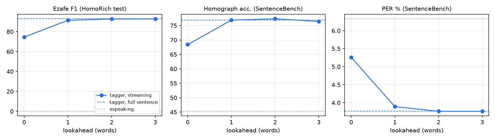

# Malayer — streaming, pronunciation-aware Persian TTS

> Persian script leaves out most vowels and the *ezafe* (the linking /e/ between words), so a
> text-to-speech front-end has to *guess* them — and the guess depends on words that, in a live
> voice agent, have not been generated yet. Malayer is an end-to-end system for that problem:
> a 4.9M-parameter alignment-preserving G2P tagger with a tunable streaming lookahead, an
> audio-level pronunciation metric validated on human speech, and a monitored serving stack with
> A/B routing, guardrails and drift detection.

<p align="center"></p>

**Headline results** (details and caveats below)

| | Malayer | espeak-ng (stock) | Published reference |
|---|---|---|---|
| SentenceBench PER ↓ (external benchmark) | **3.76 %** | 6.33 % | 4.80 % (Piper + LCA-G2P) · 3.98 % (Homo-GE2PE) |
| SentenceBench homograph accuracy | **76.9 %** | 45.3 % | 77.7 % (LCA-G2P) · 76.9 % (Homo-GE2PE) |
| HomoRich test ezafe F1 (5,000 sentences) | **92.9 %** | 0 % | — |
| Ezafe F1 with **1 word** of streaming lookahead | **91.4 %** (98 % of offline) | — | — |
| Audio: contested words where our TTS audio supports the correct reading better than stock | **83–84 %** (ezafe 88–91 %) | — | — |
| Blind A/B listening test (1 fluent rater, 40 pairs): preferred over stock | **18 – 5** (17 ties) · 78 %, p = 0.011 | — | — |
| First audio for a streamed 3-sentence LLM reply vs. wait-then-speak | **0.80 s** vs 4.17 s | — | — |
| Model size / CPU latency per sentence (1 thread) | 4.9 M params / 8.5 ms | — / 0.9 ms | ~300 M (Homo-GE2PE) |

Malayer is trained with every SentenceBench sentence removed from its training data; the published
systems were trained on a HomoRich split that contains 395 of the 400 SentenceBench sentences (§5).

---

## Contents
1. [The problem](#1-the-problem)
2. [Approach](#2-approach)
3. [Results](#3-results)
4. [Serving: A/B, guardrails, drift](#4-serving-ab-guardrails-drift)
5. [Engineering notes & things that went wrong](#5-engineering-notes--things-that-went-wrong)
6. [Reproduce](#6-reproduce)
7. [Relation to prior work](#7-relation-to-prior-work) · [Limitations](#8-limitations) · [Credits](#credits)

## 1. The problem

| Written | Without context | Correct reading | Why |
|---|---|---|---|
| کتاب خوب من | *ketāb xub man* | *ketāb**-e** xub**-e** man* | ezafe links noun → adjective → possessor; it is never written |
| پدرم مرا به شهر بازی نمی‌برد | *… nemi**bord*** | *… nemi**barad*** | homograph: برد = *bord* (won) / *barad* (takes) |
| حریف من را زد | *harif man rā zad* — "the rival hit me" | *harif**-e** man rā zad* — "(someone) hit my rival" | one missing vowel flips the meaning (example from Fetrat et al., 2025) |

espeak-ng — the phonemizer behind most lightweight Persian TTS voices — produces no ezafe at all
and resolves homographs by a fixed default. For a **voice agent** there is a second problem: an
LLM streams text word by word, and whether word *w* takes an ezafe depends on word *w+1*. A front-end
that waits for the full sentence adds seconds of latency; one that does not look ahead mispronounces.

## 2. Approach

```
LLM tokens ─▶ normalize/numbers ─▶ StreamingSession ─▶ G2P tagger ─▶ IPA (espeak-compatible) ─▶ Piper VITS ─▶ audio
                                    commit word w once        4.9M params, 1 label/char            guardrails · drift · A/B
                                    w+k words have arrived     + ezafe bit
```

**G2P as alignment-preserving tagging** (`src/malayer/g2p/`). Instead of generating a phoneme
string (seq2seq), the model assigns every input *character* a label — the phonemes it emits,
including the hidden short vowel after it (`ک→ke, ت→t, ا→a, ب→b`) — plus a per-character ezafe bit.
Consequences:
- **No hallucination by construction.** Output words map 1:1 to input words; a character can only take labels observed for it in training (`ب → {b, b/, be, bo, bb…}`), enforced by masking logits.
- **Labels from a DP aligner.** HomoRich gives sentence-level phonemes, not per-character labels. A weighted monotonic DP over a 30-line letter→realization table produces them, and *rejects* sentences it cannot explain — which turned out to be a useful noise filter (~22% of rows: consonant-only "phonemes", `@input` artifacts, doubled ezafe, romanized digraphs).
- **One model, any lookahead.** Training samples are random word-boundary prefixes (no `<eos>`) or full sentences (`<eos>`), so the last word of a prefix is trained with 0 words of right context, the one before with 1, etc. At inference the server commits word *w* once words up to *w+k* have arrived; committed words are never revised. A test asserts the live session commits exactly what the offline simulation predicts.

**Front-end → voice** (`src/malayer/tts/frontend.py`). The Mana Piper voice was trained on
espeak-style IPA. Rather than inventing a new symbol stream, Malayer aligns its phonemes to espeak's
output word by word and *transfers espeak's stress and length marks*, changing only the segments
espeak got wrong. With the tagger disabled the front-end reproduces Piper's own phonemes exactly.

**Audio-level evaluation** (`src/malayer/eval/`). Text metrics say what the front-end *asked for*,
not what the listener *hears*. ASR round-trip (Whisper WER) cannot help: Persian script omits the
very vowels being evaluated. Instead:
1. A multilingual phoneme recognizer (wav2vec2-XLSR-53, 392 IPA tokens) is projected onto the 29
   Persian phonemes with a soft confusion matrix fitted on 300 human Mana-TTS recordings.
2. **Minimal-pair forced choice**: for each word where two readings differ, compare the CTC
   likelihood of the sentence under reading A vs. reading B on the *same audio*. Only ranking is
   required, not transcription.
3. The metric is validated before use (§3.3).

## 3. Results

### 3.1 Text-level G2P

SentenceBench (400 sentences: 200 homograph, 100 Mana-TTS, 100 CommonVoice; external, never trained on):

| System | PER ↓ | Homograph acc. | Sentence acc. |
|---|---|---|---|
| espeak-ng (Piper default) | 6.33 | 45.3 | 14.3 |
| Lexicon, most frequent reading per word (no context) | 7.62 | 46.2 | 10.8 |
| **Malayer tagger, full sentence** | **3.76** | **76.9** | **38.5** |
| Malayer, streaming *k* = 0 | 5.26 | 68.4 | 24.5 |
| Malayer, streaming *k* = 1 | 3.89 | 76.9 | 37.5 |
| Malayer, streaming *k* = 2 | 3.76 | 77.4 | 39.5 |

HomoRich test split (5,000-sentence sample of the held-out split):

| System | PER ↓ | Ezafe P / R / F1 | Homograph acc. |
|---|---|---|---|
| espeak-ng | 6.45 | 0 / 0 / 0 | 49.5 |
| Lexicon (no context) | 6.56 | 0 / 0 / 0 | 60.8 |
| **Malayer, full sentence** | **1.75** | **92.8 / 93.0 / 92.9** | **81.8** |
| Malayer, streaming *k* = 0 | 3.57 | 79.5 / 70.2 / 74.5 | 71.2 |
| Malayer, streaming *k* = 1 | 1.93 | 91.0 / 91.8 / 91.4 | 80.0 |
| Malayer, streaming *k* = 2 | 1.78 | 92.4 / 92.9 / 92.7 | 80.8 |

*The lexicon baseline is worse than espeak on PER*: knowing each word's most common reading does not
help when the errors that matter are contextual (ezafe, homographs) — context is the whole problem.

**Guardrail property.** On the 5,000 test sentences the tagger's output had the input's word count
in 5,000/5,000 cases (by construction); espeak changed the word count in 41.

### 3.2 Streaming: how much right context does Persian need?

Ezafe on word *w* is decided by word *w+1*, so a zero-lookahead front-end loses 18 F1 points and most
of the homograph gain. **One word of lookahead recovers 98 % of the offline ezafe F1**; two words
match offline. In a voice agent this costs one word of buffering — at LLM speeds (~15–20 tokens/s) on
the order of 100–200 ms, and each commit costs 6 ms (p50, one CPU thread) to re-tag the prefix.

### 3.3 Audio-level pronunciation

**Validating the metric first.** The phoneme-recognizer forced choice (§2) was checked two ways:

| Validation set | Ezafe | Other vowels | All |
|---|---|---|---|
| Synthetic minimal pairs (same sentence synthesized with reading A and B; ground truth by construction) — discrimination | 92.8 % (n=153) | 81.6 % (n=87) | **88.8 %** |
| Human Mana-TTS recordings vs. HomoRich annotations (annotations are themselves noisy → lower bound) | 76.3 % (n=417) | 59.9 % (n=264) | 69.9 % |

So the metric is reliable for ezafe, usable for other vowel contrasts, and best used *comparatively*.

**End-to-end TTS on SentenceBench** (same Piper voice, only the front-end differs). For every written
word where the gold reading and espeak's reading differ (617 words), whose audio gives the gold
reading the higher relative likelihood?

Two independent evaluation runs (VITS samples noise at synthesis time, so audio differs per run):

| Malayer front-end vs. stock espeak | Win rate, run 1 | Win rate, run 2 | Run 2: wins / losses / ties |
|---|---|---|---|
| Ezafe words (n=313) | 90.5 % | 88.3 % | 263 / 35 / 15 |
| Homograph words (n=131) | 84.3 % | 90.3 % | 93 / 10 / 28 |
| Other vowel/consonant words (n=173) | 71.6 % | 66.4 % | 87 / 44 / 42 |
| **All contested words (n=617)** | **84.4 %** | **83.3 %** | 443 / 89 / 85 |
| — streaming *k* = 1, all | 84.0 % | 84.5 % | 447 / 82 / 88 |

Win rates exclude ties (|ΔLLR| ≤ 0.5). Category-level rates move by up to ±6 points between runs;
the overall rate by ~1 point.

The voice realizes **80–83 %** of the phoneme edits the front-end makes relative to espeak (measured
the same way), i.e. the acoustic model mostly — not always — follows injected corrections. Synthesis
speed is unchanged by the front-end (CPU RTF 0.084 vs 0.084 in run 1; 0.14 vs 0.14 in run 2, which
ran alongside other jobs).

### 3.4 Blind listening test

40 SentenceBench homograph sentences where the two front-ends send different phonemes; each played
as a randomized, blind A/B pair (`/listen`); the rater (a fluent Persian speaker — the author) picks the
reading whose *pronunciation* is correct, or "same / both wrong".

| Malayer preferred | Stock preferred | Same / both wrong | Preference (excl. ties) | Wilson 95 % CI | Sign test |
|---|---|---|---|---|---|
| 18 | 5 | 17 | **78.3 %** | 58.1 – 90.3 % | p = 0.011 |

This is a single rater and a small sample — supporting evidence for the automatic metrics, not a
MOS study. The 5 losses are genuine model errors: wrong homograph sense (کشتی → *koshti* "wrestling"
instead of *kashti* "ship"; سبکی → *sabokī* instead of *sabkī*), a spurious ezafe (در عالم بی دلیل),
and a dropped vowel (مزن → *mazn*). Most ties are homographs that **both** systems got wrong (کرم,
مه, ملک) — consistent with the ~77 % homograph ceiling in §3.1. Raw result: `docs/listening_results.json`.

Listen: [`docs/samples/`](docs/samples/) has side-by-side WAVs (espeak / Malayer / Malayer streaming)
for homograph sentences, with the phonemes each system sent to the voice in `manifest.json`.

## 4. Serving: A/B, guardrails, drift

`src/malayer/serve/` — FastAPI service (`make serve`), exercised end-to-end by `make simulate`.

| Capability | Implementation |
|---|---|
| A/B routing | deterministic `sha256(salt:session) → arm`; control = stock espeak front-end, treatment = tagger |
| Always-valid testing | mixture SPRT (Johari et al., 2017) — p-values stay valid under continuous monitoring; an A/A simulation in the tests keeps false positives ≤ 5% with a peek after every observation |
| Streaming | WebSocket `/v1/stream`: LLM fragments in, PCM chunks out; lookahead *k* and first-phrase size are per-session knobs |
| Guardrails (every response) | non-finite output, clipping, internal dropouts > 1.2 s, speaking rate outside 0.03–0.25 s/phone (truncation / run-away), unreadable characters |
| Drift | PSI of input length, unknown-character rate, predicted ezafe rate, tagger confidence vs. a dev-set reference; zero-inflated features handled with open-ended bins |
| Metrics | Prometheus `/metrics` (latency by stage, TTFA, RTF, violations, PSI, experiment p-values), JSON `/dashboard` |
| Human eval | `/listen`: blind, randomized A/B listening test; votes in SQLite; `make listen-report` |

**Simulation results** (`runs/serving_report.json`; 790 `/v1/tts` requests + 40 streamed replies, in-process):

| Phase | Requests (control / treatment) | Guardrail violations | Drift alerts (PSI > 0.2) |
|---|---|---|---|
| Normal: formal Persian (HomoRich test) | 209 / 191 | 0 | none (all PSI ≤ 0.03) |
| Shifted: colloquial text, Finglish, mixed script, digits | 180 / 210 | 78 — all `unreadable_characters` (37 / 41) | input length 0.22 · unknown chars 1.19 · ezafe rate 0.27 |

The guardrail-pass A/B under shifted traffic: 90.5 % vs 89.8 %, always-valid p = 0.73 — correctly *not*
declared different. Streaming (3-sentence replies arriving at ~60 chars/s):

| Arm | First audio, streaming (p50) | First audio, wait for full reply then synthesize (p50) |
|---|---|---|
| control (espeak) | 0.74 s | 3.98 s |
| treatment (Malayer, *k* = 1) | 0.80 s | 4.17 s |

The tagger adds ~60 ms to time-to-first-audio; streaming removes ~3.4 s.

## 5. Engineering notes & things that went wrong

- **Benchmark leakage.** HomoRich's *recommended* train split contains **395 of SentenceBench's 400 sentences** verbatim (and 6,967 sentences shared with its own test split). Malayer removes every evaluation sentence from training; published numbers trained on that split should be read with this in mind.
- **Noisy references limit human-speech calibration.** Inspecting forced-choice "errors" on human audio showed most were annotation errors (ezafe marked where the speaker did not say one, wrong vowels), not recognizer errors — hence the synthetic minimal-pair validation with ground truth by construction.
- **fp16 is 4× slower on a GTX 1650.** Mixed precision is opt-in (`--amp`); benchmark before enabling on TU117 GPUs.
- **OOM from length outliers.** A fixed 128-sentence batch crashed at epoch 3 when a bucket of 300-character sentences came up; batches are now capped by padded tokens.
- **A metric bug that looked like a model bug.** Homograph accuracy first looked *worse* than espeak; the cause was the decoder merging written words that the reference joins phonologically, misaligning word positions. Word boundaries now always follow the input.
- **Guardrails caught two real regressions.** (1) The treatment arm produced silent audio for Latin-script tokens (brand names, Finglish) that the tagger has no labels for — `all_silence` fired 16× vs. 3× in control; fixed with a per-token espeak fallback. (2) The remaining `all_silence` hits in *both* arms were short phrases ("کمتر می‌شه .") coming out ~25 dB too quiet: calling the VITS model directly bypassed Piper's loudness normalization. Both fixed with regression tests; `all_silence` is now 0.
- **Stochastic synthesis.** VITS samples noise at inference, so audio-level results vary between runs; the README reports two runs rather than one.

## 6. Reproduce

Hardware used: GTX 1650 (4 GB), 15 GB RAM. ~3.3 GB of downloads.

```bash
make setup          # venv + deps
make data           # download assets, build tagging data (~3 min)
make train          # ~1.7 h on a GTX 1650
make calibrate      # recognizer projection + validation (~45 min CPU)
make eval-g2p       # text metrics, lookahead curve, latency
make eval-audio     # audio-level evaluation, writes docs/samples/
make simulate       # A/B + drift + streaming simulation through the service
make serve          # http://localhost:8000/listen for the listening test
make test
```

## 7. Relation to prior work

- **GE2PE / Homo-GE2PE** (Rahmati & Sameti 2024; Qharabagh et al. 2025): T5-based seq2seq Persian G2P, strong accuracy, ~300M parameters, autoregressive.
- **HomoRich / HomoFast eSpeak** (Qharabagh et al. 2025): the dataset used here, and a homograph-aware espeak extension.
- **Piper + LCA-G2P** (Fetrat et al., 2025, *Beyond Unified Models*): espeak + co-occurrence homograph correction + a distilled 11M ALBERT ezafe tagger, run as services; the Mana voice used here was fine-tuned on its phonemes. Reported on SentenceBench: PER 4.80, ezafe F1 90.08, homograph acc. 77.67.

Malayer differs in: a single small character-level model for vowels, homographs and ezafe together;
structural no-hallucination guarantee; explicit **streaming lookahead** analysis for LLM-driven
agents; **audio-level** evaluation validated on human and synthetic speech; and the production
layer (sequential A/B testing, guardrails, drift). It does not claim state-of-the-art homograph
accuracy — see §3.

## 8. Limitations

- **SentenceBench ezafe.** On SentenceBench our ezafe F1 is 75.9 %, below the 90.1 % reported for LCA-G2P. SentenceBench marks ezafe inconsistently (written-ezafe forms like *-hāye* are usually unmarked), so we treat this number as unreliable for every system and report ezafe on HomoRich instead — but the metrics are not computed identically, and the gap may also be real.
- **Homograph accuracy is on par, not better.** 76.9 % matches Homo-GE2PE and is slightly below LCA-G2P (77.7 %), with ~60× fewer parameters than Homo-GE2PE and no SentenceBench leakage.
- **Training labels are noisy.** HomoRich is partly LLM-annotated; the aligner removes the worst rows but cannot fix plausible-looking errors. Test references share this noise.
- **The audio metric is a proxy.** 88.8 % discrimination on synthetic pairs and 69.9 % agreement with noisy human-speech labels; "other vowel" contrasts are measured less reliably than ezafe. The listening test that complements it has one rater (the author) and 40 items.
- **Streaming chunks are synthesized independently**, so prosody resets at phrase boundaries; a production system would carry prosodic state across chunks.
- **Persian script only.** Latin-script tokens fall back to espeak; there is no code-switching G2P.

## Credits

Data and models: [HomoRich](https://huggingface.co/datasets/MahtaFetrat/HomoRich-G2P-Persian) (CC0),
[SentenceBench](https://huggingface.co/datasets/MahtaFetrat/SentenceBench) (evaluation only),
[Mana-TTS](https://huggingface.co/datasets/MahtaFetrat/Mana-TTS) (CC0),
[Mana Persian Piper](https://huggingface.co/MahtaFetrat/Mana-Persian-Piper) (MIT),
[wav2vec2-xlsr-53-espeak-cv-ft](https://huggingface.co/facebook/wav2vec2-xlsr-53-espeak-cv-ft) (Apache-2.0),
[Piper](https://github.com/OHF-Voice/piper1-gpl) / espeak-ng.
