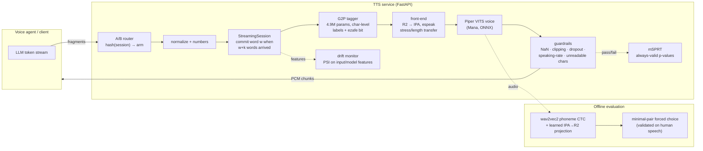

# Architecture

## Components

| Module | Role | Key design decision |
|---|---|---|
| `text/normalize.py`, `text/numbers.py` | canonical Persian text, digits → words | character-local mappings, so tagger labels stay aligned with the input |
| `g2p/align.py` | builds training labels from sentence-level phonemes | weighted monotonic DP over a 30-line letter→realization table; rejects ~22% of HomoRich rows as noisy annotations |
| `g2p/model.py` | transformer encoder tagger | one label per input character, constrained to labels seen for that character → cannot insert/drop/repeat words |
| `g2p/data.py` | random-prefix truncation + `<eos>` | one model serves any lookahead *k*; `<eos>` separates "sentence complete" from "more text coming" |
| `g2p/infer.py` | offline + streaming inference | streaming commits are final: re-tag the visible prefix, freeze only the newly committable word |
| `tts/frontend.py` | R2 → IPA for the voice | keeps espeak's suprasegmental marks (the voice's training distribution) and replaces only segments |
| `eval/phoneme_ctc.py` | audio-level pronunciation metric | soft projection of a multilingual recognizer onto Persian phonemes; forced choice instead of free transcription |
| `serve/*` | API, streaming, guardrails, drift, experiments, listening test | deterministic arm assignment, always-valid sequential testing, blind pairwise listening test |

## Why character tagging instead of seq2seq G2P

Seq2seq G2P models (e.g. T5/ByT5-style GE2PE) generate phonemes freely. In a production TTS
front-end that means a small but non-zero chance of hallucinated, skipped or repeated words — the
same class of failure that makes LLM-based TTS hard to ship. Tagging ties every output to an input
character, so word count and order are preserved by construction, decoding is a single
non-autoregressive pass, and the label space per character is a short whitelist.

## Why bounded lookahead

Ezafe is decided by the *following* word (`کتاب خوب` *ketāb-e xub* vs. `کتاب خواندم` *ketāb xāndam*),
so a streaming voice agent cannot pronounce word *w* until it has seen some right context. The tagger
is trained on random prefixes and evaluated with *k* = 0…3 words of lookahead; the server exposes *k*
as a latency/accuracy knob.

## Why forced choice for audio evaluation

Persian script omits short vowels and ezafe, so ASR-based round-trip metrics (WER/CER against the
input text) cannot see the very errors this project fixes. A phoneme recognizer can, but zero-shot
phoneme recognition is noisy. Comparing the likelihood of two *readings* of the same audio only
requires ranking, and its reliability is measured on human recordings before it is used on TTS.
