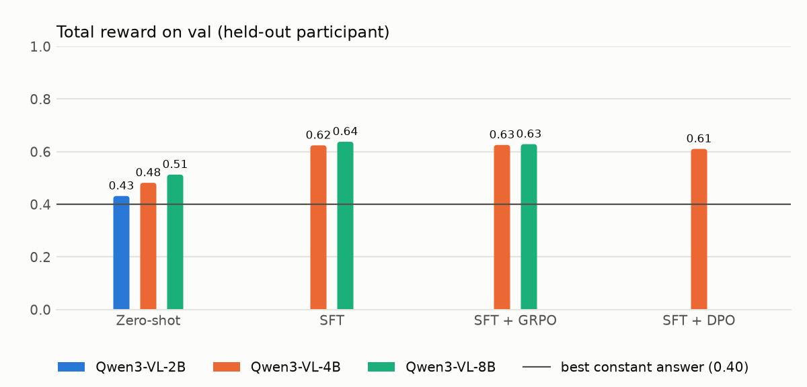
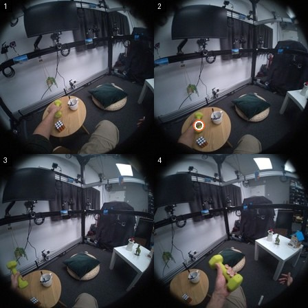
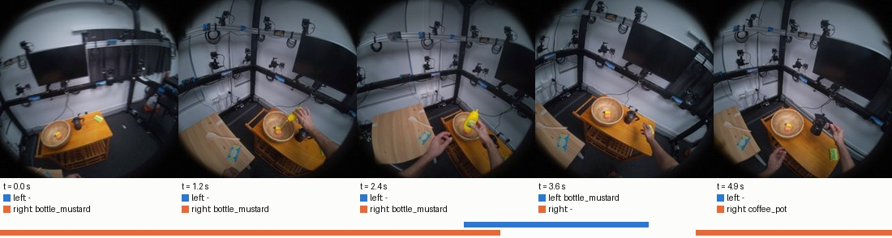
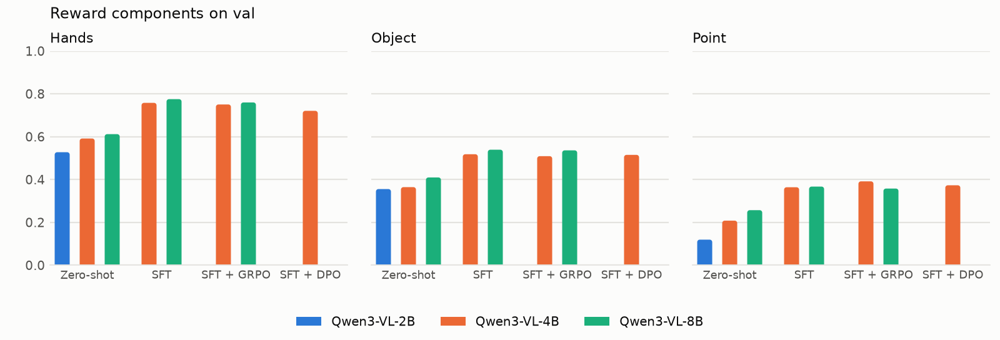
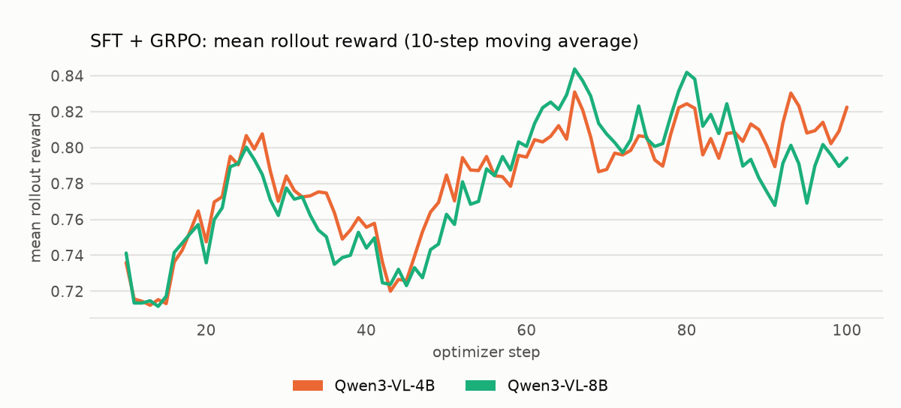
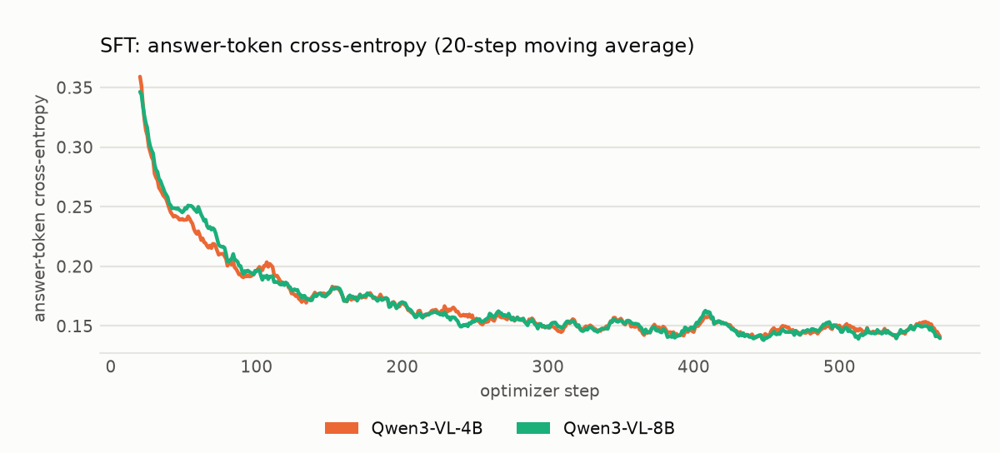

# Sensor-Verified Post-Training of a VLM Annotator for Egocentric Hand–Object Video

> Robot-learning datasets built from human demonstrations need dense labels — which hand is holding
> what, when the grasp starts, where the object is — and today those labels are typically written by
> a closed VLM (e.g. Gemini) or by people. Motion-capture rigs already *measure* these facts. This
> project turns the measurements into **verifiable rewards** and post-trains open Qwen3-VL models
> (4B and 8B) with **SFT, GRPO and DPO** to label RGB-only video, so a sensor-equipped capture can
> teach a model that then labels footage from cheap cameras.

<p align="center"></p>

**Findings so far.** SFT, GRPO and DPO have been run on Qwen3-VL-4B and 8B (DPO on 4B so far).
SFT adds 0.12–0.14 reward over zero-shot. GRPO and DPO on top of SFT do **not** improve on a new
person, and [Section 5](#5-results) shows why: GRPO only sharpened sampling toward answers SFT already
gave greedily, and both methods amplified a hand-use habit of the training participants.

**Status: in progress.** Next: test-set and Quest 3 (new people, new camera) evaluation, DPO at 8B,
the fixes listed in [Section 5.4](#54-next), and the 2B runs on a local 4 GB GPU. Test-set numbers are
held back until the final models are fixed. Validation (one held-out participant, 332 samples):

| | Total reward | Hands (8 per-frame bits) | Object name | Point on object |
|---|---|---|---|---|
| Best constant answer | 0.400 | | | |
| Qwen3-VL-8B zero-shot | 0.513 | 0.61 | 0.41 | 0.26 |
| Qwen3-VL-4B + SFT | 0.624 | 0.76 | 0.52 | 0.36 |
| Qwen3-VL-4B + SFT + GRPO | 0.626 | 0.75 | 0.51 | **0.39** |
| Qwen3-VL-4B + SFT + DPO | 0.611 | 0.72 | 0.52 | 0.37 |
| Qwen3-VL-8B + SFT | **0.638** | **0.78** | **0.54** | 0.37 |
| Qwen3-VL-8B + SFT + GRPO | 0.629 | 0.76 | 0.54 | 0.36 |

Full tables, with paired confidence intervals: [docs/results_val.md](docs/results_val.md).

---

## Contents
1. [The task](#1-the-task)
2. [Labels from motion capture](#2-labels-from-motion-capture)
3. [Rewards](#3-rewards)
4. [Training: SFT, GRPO, DPO](#4-training-sft-grpo-dpo)
5. [Results](#5-results)
6. [Engineering notes & things that went wrong](#6-engineering-notes--things-that-went-wrong)
7. [Reproduce](#7-reproduce)
8. [Relation to prior work](#8-relation-to-prior-work) · [Limitations](#9-limitations) · [License](#license)

## 1. The task

Each sample is four frames of a 5-second egocentric clip, evenly spaced over 1.2–4.8 s and tiled
2×2 (448 px). The model answers in JSON:

```json
{"left": [0, 1, 1, 1], "right": [0, 0, 0, 0], "object": "dumbbell_5lb", "point": [646, 408]}
```

- `left` / `right` — is that hand holding or moving an object in frames 1–4,
- `object` — which object is manipulated, chosen from the scene's object list (or `"none"`),
- `point` — where that object is in the first frame where it is held and visible (Qwen3-VL's 0–1000
  grounding convention).

Every field is checkable against motion capture, so every field can be a reward.

<p align="center"></p>

**Data.** [HOT3D-Clips](https://github.com/facebookresearch/hot3d) (Meta): 5-second, 30 fps clips
with marker-based motion capture of both hands (UmeTrack) and every object (6-DoF), plus per-frame
object masks. All 1,516 Aria training clips (RGB, 9 participants) are streamed, reduced to ~1.3 MB
each and deleted ([`scripts/00_fetch_hot3d.py`](scripts/00_fetch_hot3d.py)), giving 4,556 / 332 / 542
train / val / test samples **split by participant** (7 / 1 / 1). A second test set,
**`test_quest3`**, uses Quest 3 headset clips of **4 people who never appear in the Aria data**,
recorded by a different, grayscale camera — new people *and* new capture hardware (1,524 samples).

## 2. Labels from motion capture

HOT3D objects rest on the table unless a hand moves them, and resting objects' mocap poses are
steady (speed p99.9 = 0.007 m/s). A hand **manipulates** an object when it touches it during a
contact that also moves the object; touching a resting object (typing on a keyboard) is not
manipulation. "Touch" is measured two ways ([`src/sensor_vlm/labels.py`](src/sensor_vlm/labels.py)):

| | how | used for |
|---|---|---|
| **contact** (default) | UmeTrack hand mesh (788 vertices, Meta's `hand_tracking_toolkit`) within 1 cm of the object's surface (≥ 5 vertices) | all training and evaluation |
| wrist (baseline) | wrist within 13.5 cm of the object surface while it moves | label-quality ablation |

On 534 clips the two agree on 89.5 % of hand-frames. Contact adds 9 % — objects held still, and
large objects held with the wrist beyond reach; 8 of 8 random disagreements checked by eye were real
holds — and starts grasps 0.2–0.4 s earlier, when the fingers close rather than when the object moves.

<p align="center"></p>

## 3. Rewards

[`src/sensor_vlm/rewards.py`](src/sensor_vlm/rewards.py) scores a completion from the sample alone; each
field is scored on its own so one malformed field does not zero the rest:

| component | weight | definition |
|---|---|---|
| format | 0.1 | all four fields well-formed |
| hands | 0.4 | fraction of the 8 per-hand, per-frame bits that match |
| object | 0.25 | exact object name (or `"none"`) |
| point | 0.25 | the point lands on the object's mask (128×128, from HOT3D) in the right quadrant; for `"none"`, the point must be `null` |

Constant answers set the floor: the best (`right hand busy in all frames, most common object`) scores
0.400 on val.

## 4. Training: SFT, GRPO, DPO

All three are implemented from scratch on 4-bit NF4 Qwen3-VL + LoRA (r = 16, language model only;
the vision tower stays frozen) — [`src/sensor_vlm/train.py`](src/sensor_vlm/train.py),
[`src/sensor_vlm/rl.py`](src/sensor_vlm/rl.py), with unit tests for the objectives.

- **SFT** ([`scripts/03_sft.py`](scripts/03_sft.py)) — token cross-entropy on the answer only;
  1 epoch, effective batch 8, lr 1e-4 cosine. Batches are left-padded so every answer ends at the last
  position and only the answer's logits are materialized (the 152k vocabulary would not otherwise fit
  in 4 GB).
- **GRPO** ([`scripts/04_grpo.py`](scripts/04_grpo.py)) — from the SFT adapter; 4 prompts × 4 sampled
  completions per step (temperature 1), group-normalized advantages (std or Dr.-GRPO-style
  centering), PPO-clipped ratio, optional k3 KL to the base model (off by default); groups whose
  completions all score the same carry no signal and are skipped. 100 steps, lr 1e-5.
- **DPO** ([`scripts/06_dpo.py`](scripts/06_dpo.py)) — pairs from the SFT policy's own samples ranked
  by the same reward (best vs worst of 4, kept if they differ by ≥ 0.25: 263 pairs from 500
  prompts); reference log-probs are computed once at pair time, so training needs no second model.
  β = 0.1, 2 epochs. Same reward, similar sample budget as GRPO: offline preferences vs online RL.

**Compute.** 2B runs locally on a 4 GB GTX 1650; 4B and 8B run on Kaggle's free T4 ×2 (fp16 with loss
scaling), within a 6 GPU-hour weekly quota — both GPUs always run in parallel
([`kaggle/run_t4.py`](kaggle/run_t4.py)).

## 5. Results

On the held-out participant, SFT is where the gain is: +0.14 (4B) and +0.12 (8B) total reward over
zero-shot, in every component. The rest of this section is about why GRPO and DPO add nothing on
top of it.

<p align="center"></p>

**Change from SFT, same samples** (mean, 95 % paired bootstrap interval):

| | Total | Hands | Point |
|---|---|---|---|
| 4B + GRPO | +0.002 [−0.012, +0.014] | −0.008 [−0.018, +0.003] | +0.028 [+0.000, +0.055] |
| 4B + DPO | −0.014 [−0.029, +0.001] | **−0.037** [−0.054, −0.021] | +0.009 [−0.024, +0.043] |
| 8B + GRPO | −0.009 [−0.023, +0.005] | **−0.015** [−0.029, −0.003] | −0.009 [−0.046, +0.028] |

### 5.1 No reward hacking

GRPO and DPO answers stay 100 % well-formed, completions stay at ~51 tokens, and answers still vary
from sample to sample. The models did not find a loophole in the reward; the problem is elsewhere.

### 5.2 GRPO sharpened sampling; it did not learn new answers

During GRPO the mean rollout reward on training prompts rose from 0.76 to 0.81 (slope p < 0.01 at
both sizes):

<p align="center"></p>

But the two curves move together because both runs drew the same prompts in the same order, so much
of their shape is prompt difficulty. And rollouts are sampled at temperature 1, while evaluation
decodes greedily. To separate the two, SFT and GRPO models were decoded greedily on 240
training-participant prompts that no GRPO or DPO run had used ([`kaggle/train_probe_ids.txt`](kaggle/train_probe_ids.txt),
[docs/results_train_probe.md](docs/results_train_probe.md)):

| greedy, training participants | SFT | SFT + GRPO | change (95 % CI) |
|---|---|---|---|
| Qwen3-VL-4B | 0.805 | 0.802 | −0.003 [−0.013, +0.008] |
| Qwen3-VL-8B | 0.810 | 0.802 | −0.009 [−0.023, +0.005] |

Greedy SFT already scores what GRPO's samples climbed to, and GRPO's greedy answers are no better. Within
a group, the share of hand bits the four samples disagree on halved (0.28 → 0.14 for 4B, 0.40 → 0.14
for 8B). GRPO moved the sampling distribution onto the answers the SFT model already gave greedily —
the "RL sharpens, it doesn't discover" pattern reported for LLM reasoning (Yue et al., 2025). With a
within-group reward spread of only 0.06–0.09, there was little better to discover in 1,600 rollouts.

### 5.3 Post-training amplified a habit of the training participants

How often the model says a hand is busy (fraction of frames):

| | left hand | right hand |
|---|---|---|
| labels, the 7 training participants | 0.49 – 0.55 | 0.54 – 0.78 |
| labels, val participant | **0.37** | 0.66 |
| labels, test participant | **0.28** | 0.57 |
| 4B SFT, on val | 0.54 | 0.76 |
| 4B SFT + GRPO, on val | 0.58 | 0.78 |
| 4B SFT + DPO, on val | **0.66** | 0.84 |

The held-out people use their left hand less than anyone in training, and SFT carries the training
rate over to them. GRPO raised it further, on training participants too (0.58 → 0.61 against 0.54 in
the labels), so the shift is a side effect of RL, not better fitting. DPO's shift has a visible
cause in its pairs: the worse answer of a pair more often *missed* a real hold (1.52 false negatives
vs 1.05 false positives per answer), so "busier" is the preferred direction — and DPO learned it as
a global shift, costing 3.7 points of hand accuracy, the clearest effect in the table above.

The gap that matters is between people: the same SFT 4B model scores 0.805 on training participants
(on prompts it saw once during SFT, so partly memorized) and 0.624 on a new one.

### 5.4 Next

- RL where SFT has not already fit: hold participants out of SFT and use them only for GRPO, or keep
  only prompts the SFT model gets wrong.
- More exploration per prompt: larger groups and higher temperature, so groups contain answers better
  than the greedy one.
- DPO with pairs balanced between missed and invented holds, or with a likelihood term on the chosen
  answer.
- Test and Quest 3 (new people, new camera) evaluation of all models.

SFT training loss:

<p align="center"></p>

## 6. Engineering notes & things that went wrong

- **4B does not fit in 4 GB.** Even 4-bit with the vision tower and embeddings offloaded, the language
  model's weights alone take 2.5 GB of the 3.6 GB usable; 2B fits at ~2 GB peak for SFT, GRPO and DPO.
- **fp16 is ~23× slower than fp32 on a GTX 1650.** The vision tower takes 9.4 s per tile in fp16 and
  0.40 s in fp32; running it in fp32 made SFT steps ~5× faster. The T4 has fast fp16, so Kaggle runs use
  fp16 throughout.
- **Laptop power brake.** Under sustained load the GPU cycles ~25 s at 1.6 GHz then 40–60 s at 348 MHz
  with no throttle reason reported (on AC, while charging) — about half the throughput.
- **`generate()` mutates cached vision features** passed as `mm_encoder_outputs` (it expands them in
  place for `num_return_sequences`), so the next training step saw 4× the image tokens. Fixed by
  passing a copy.
- **A shadowed variable** (`h` for image height, reused as the hand index) silently rotated every Quest
  3 box by the wrong height from frame 3 on; a mask-inside-box test on a real clip caught it before any
  data was built.
- **The zero-shot prompt was ambiguous** (`"left": [4 ints]` → the model answered `[3, 3, 3, 3]`);
  rewording the format line took format validity to 100 % — a fair baseline needs a clear prompt.
- **Resumes are bit-exact**: a run restarted from a checkpoint reproduces the original loss to all
  printed digits (same data order, optimizer state and seed).

## 7. Reproduce

```bash
make setup          # venv + package (+ hand_tracking_toolkit from GitHub)
make data           # stream HOT3D-Clips (Aria), ~1.5 h, ~2 GB kept
make tasks          # contact labels -> 4-frame tile tasks in data/tasks
make eval           # zero-shot Qwen3-VL-2B on val
python scripts/03_sft.py  --out runs/sft_2b                                   # local 2B
python scripts/04_grpo.py --adapter runs/sft_2b/adapter --out runs/grpo_2b
python scripts/06_dpo.py  --adapter runs/sft_2b/adapter --out runs/dpo_2b
python scripts/05_kaggle_bundle.py --user <kaggle-user>                       # 4B / 8B on Kaggle T4 x2
python scripts/07_report.py --split val                                       # tables + figures
python scripts/02_evaluate.py --adapter runs/sft_2b/adapter --out runs/sft_2b --split train \
    --ids-file kaggle/train_probe_ids.txt --name train_probe                    # sharpening check
python scripts/07_report.py --split train_probe --base-split train
```

## 8. Relation to prior work

- **EgoLAP** (2026) trains on the Mecka subset of EgoVerse with reasoning labels written offline by
  Gemini, and post-trains a 2B policy backbone with a GRPO reward that matches parsed hand-motion
  "language actions" to demonstrated motion. Here the labels themselves come from measured contact, and
  the model being trained is the annotator.
- **Robot reward VLMs** — RoboReward, Robometer, ProcVLM (2026) — score robot rollouts for progress
  and success; this project labels *human* demonstrations, where the supervision comes from hand and
  object motion capture rather than task success.
- **Egocentric VLM RL** — EgoVLM and follow-ups apply GRPO to egocentric video QA with human-written
  answers; the rewards here need no human answers at all.
- **What RL with verifiable rewards adds** — Yue et al. (2025, "Does Reinforcement Learning Really
  Incentivize Reasoning Capacity in LLMs Beyond the Base Model?") find that it mostly concentrates
  sampling on answers the starting model can already produce; Section 5.2 is the same effect, measured
  on a perception task.

## 9. Limitations

- One validation and one test participant (HOT3D's Aria clips cover 9 people); the Quest 3 set adds
  4 unseen people on a different camera.
- Four frames per sample, not video: grasp timing is only resolved to the tile spacing (0.4–1.6 s).
- "Manipulation" requires the object to move during the contact; holding an object that never moves in
  the clip is not labeled.
- QLoRA on 4-bit weights, not full fine-tuning.
- Small RL budgets (free GPU quota): 100 GRPO steps × 16 rollouts and 263 DPO pairs per model. The
  negative GRPO/DPO result is for this budget and this SFT starting point.

## License

Code: BSD 3-Clause (repository [LICENSE](../LICENSE)). Data derived from HOT3D: video and object annotations are CC BY-SA, hand annotations
CC BY-NC-SA — derived labels and trained adapters are released for non-commercial use only.
